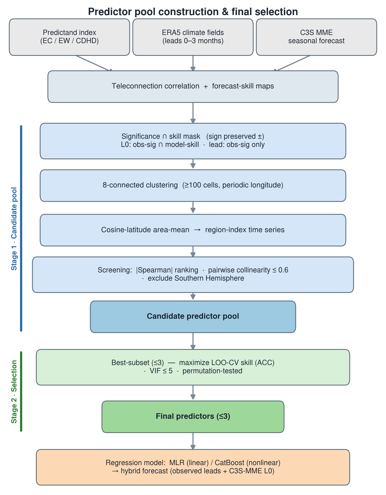

# Statistical–Dynamical Hybrid Model for Hard-to-Predict Climate Variables — Summer CDHD (Linear)

A **statistical–dynamical hybrid** approach to **seasonal prediction of climate variables that dynamical models cannot forecast well directly** — air quality (e.g. PM10), atmospheric blocking, warm/cold extremes — by **bridging** such targets to the large-scale fields a **multi-model ensemble** *does* forecast skilfully. **This repository is the linear (MLR) core for Korean summer compound hot–dry extremes (CDHD).**

Statistical–dynamical (multiple linear regression, **MLR**) seasonal prediction of **Korean summer compound hot–dry extremes (CDHD)** over the July–August (JA) season.

This repository contains the research implementation of the **linear statistical–dynamical model** developed in the Korea Meteorological Administration (KMA) R&D project *“AI-based research on climate-extreme variability and prediction”* (Sejong University component). The model predicts a **compound dry–hot index (CDHD)** over the Korean Peninsula from physically-motivated, skill-screened predictors.

## Overview

Pure dynamical models have limited skill for regional seasonal extremes, while purely data-driven models struggle with the short observational record. This model takes a **statistical–dynamical (hybrid)** approach: a lean, interpretable linear regression built on physical predictors that are screened to those a dynamical multi-model ensemble forecasts skillfully.

- **Predictand:** JA compound hot–dry index **CDHD** over Korea, combining heatwave intensity and drought:
  `CDHD = ( log1p(HWD) / σ ) × ( − SPEI3 )`,
  where `HWD` = Korean heatwave-day count and `SPEI3` = standardized precipitation–evapotranspiration index.
- **Predictors:** two **concurrent (L0, July–August) large-scale drivers** that the dynamical multi-model ensemble forecasts skilfully — tropical **North-Atlantic 2-m temperature** and eastern **Indian-Ocean 10-m meridional wind** (the "track-A" concurrent pair).
- **Estimator:** multiple linear regression (this repo). The non-linear (CatBoost) counterpart is in a sibling repository.

## How CDHD is computed

**CDHD** (compound hot–dry) merges summer heat and drought into a single index:

```
CDHD = ( log1p(HWD) / σ_logHWD ) × ( −SPEI3 )
```

- **HWD — heatwave-day count.** From ERA5 daily maximum temperature: at each grid cell the day-of-year 90th percentile is taken over the 1981–2010 base period with a ±7-day window, and a heatwave day is tmax exceeding that threshold on ≥3 consecutive days. HWD is the July–August count, cos-latitude-weighted over the Korea box (32.5–45°N, 122.5–132.5°E). `log1p(HWD)` compresses the right-skewed count and is divided by its 1979–2024 standard deviation (`σ_logHWD`).
- **SPEI3 — drought.** The 3-month Standardized Precipitation–Evapotranspiration Index for July–August over Korea (SPEIbase v2.11), normalized over 1979–2024. SPEI3 < 0 under drought, so **−SPEI3** is the drought magnitude.
- **Product.** Standardized heat × drought makes CDHD large only when a summer is **both hot and dry** — a hot-but-wet or cool-but-dry summer scores low. CDHD is defined on the Korea-mean series (one value per year, 1979–2024) and is distributed as the predictand file `ERA5_JA_CDHD_index_1979-2024.nc` (variable `korea_nday`).

## How the predictors are built



Predictors are built in **two stages** — an automated, physically-constrained *candidate-pool construction* (identical across all four model variants — summer/winter × linear/nonlinear) followed by a *final selection* that keeps only the few predictors maximising out-of-sample skill.

**Stage 1 — candidate pool.** The detrended predictand index is correlated against global ERA5 climate fields (T2m, MSL, SST, Z500, U200, V200, T850, Z850, precipitation, …) at lead times of 0–3 months, and the C3S multi-model-ensemble (MME) forecast skill is mapped for each field in parallel. A grid cell becomes a predictor source only where it is physically *and* operationally useful, through a **dual-condition significance mask**:

- **concurrent (L0)** fields must be **both** significantly correlated with the predictand (Spearman, *p* < 0.05) **and** skilfully forecast by the dynamical ensemble (skill significant, *r* > 0) — so the statistical link can actually be exploited at forecast time;
- **lead (L1–L3)** fields require only observational significance, since they are already observed when the forecast is issued.

The relationship sign (±) is preserved. The mask is segmented into coherent regions by **8-connected component labelling** (periodic in longitude), keeping only clusters of **≥ 100 grid cells**, and each region is reduced to one **cosine-latitude area-mean** index time series. Candidates are ranked by |Spearman| with the predictand, then filtered by a **greedy pairwise-collinearity rule** (drop any with |Spearman| > 0.6 against an already-accepted index) and a **Southern-Hemisphere exclusion** — yielding the *candidate predictor pool* (≈ 70–80 regions per predictand).

**Stage 2 — final selection.** From the pool, **all subsets of up to three predictors** are scored by **leave-one-out cross-validated skill (anomaly correlation, ACC)** with a closed-form LOOCV (PRESS); multicollinearity is bounded by **VIF ≤ 5**, and the selected model's skill is tested against chance by a **permutation test**. Keeping the predictor count small (≤ 3) avoids overfitting the short (~45-season) record. The final predictors feed the regression model (**MLR** in the linear repositories, **CatBoost** in the nonlinear ones) — concurrent (L0) terms supplied operationally by the distribution-calibrated C3S-MME forecast, lead terms by observations.

## Method (pipeline)

| step | script | description |
|---|---|---|
| 1 | `src/00_corr_leads.py` | Detrended correlation of the predictand against global climate fields at leads 0–3 months (teleconnection diagnosis). |
| 2 | `src/01_make_predictor_index.py` | Predictor-pool construction: (observation significance) ∩ (dynamical-ensemble forecast skill) mask → **8-connected clustering (≥100 grid cells, periodic in longitude)** → cosine-latitude area-mean index → greedy collinearity screening (pairwise \|Spearman\| ≤ 0.6) + Southern-Hemisphere exclusion. |
| 3 | `src/02_select_mlr.py` | Final predictor selection: **best-subset (≤3 predictors)** maximizing **leave-one-out cross-validated skill (ACC)**, with VIF ≤ 5 multicollinearity control. |
| 4 | `src/03_forecast_hybrid.py` | Forecast / cross-validated skill. (L0 terms, where selected, are supplied by a distribution-calibrated C3S-MME forecast; CDHD uses observed lead predictors.) |

## Selected predictors (final CDHD model)

The CDHD deliverable model (**track A**) uses two **concurrent (L0, July–August) large-scale drivers** that the dynamical multi-model ensemble forecasts skilfully, in place of lead-time precursors. Coefficients (**β**) are standardised (z-scored, detrended; fit over 1979–2024).

| predictor | lead | variable | region | β (std.) |
|---|---|---|---|---|
| α | L0 (JA) | 2-m temperature | tropical North Atlantic (≈14.5°N, 44°W) | −0.40 |
| β | L0 (JA) | 10-m meridional wind | eastern Indian Ocean / Bay of Bengal (≈9°N, 90°E) | +0.26 |

A warm tropical North Atlantic and anomalous Indian-Ocean low-level southerlies favour a hot–dry Korean summer; leave-one-out cross-validated skill is ACC ≈ **0.45**. Both predictors are supplied operationally by the C3S multi-model-ensemble forecast.

## Repository structure

```
.
├── src/
│   ├── 00_corr_leads.py           # teleconnection correlation maps (predictand vs fields, leads 0–3)
│   ├── 01_make_predictor_index.py # predictor-pool construction (mask → cluster → index → screen)
│   ├── 02_select_mlr.py           # best-subset MLR selection (LOOCV + VIF)
│   └── 03_forecast_hybrid.py      # forecast / hybrid skill
├── data/                          # input data (not included — see data/README.md)
├── requirements.txt
└── README.md
```

## Data

Raw datasets are **not included** (size / licensing). Place inputs under `./data/` (or set the path at the top of each script). Required inputs and sources:

- **ERA5** monthly atmospheric fields — Copernicus Climate Data Store (CDS).
- **Heatwave-day index** `ERA5_JA_HW_index_1979-2024.nc` (ERA5-based), and **SPEI** (`SPEIbase` v2.11) — for the CDHD predictand.
- **C3S seasonal multi-model** hindcast/forecast (dynamical predictors) — CDS.

See `data/README.md` for the expected file list and format.

## Usage

```bash
pip install -r requirements.txt
# place inputs under ./data  (see data/README.md)
python src/00_corr_leads.py           # teleconnection correlations
python src/01_make_predictor_index.py # build predictor pool
python src/02_select_mlr.py CDHD      # final MLR selection
python src/03_forecast_hybrid.py      # forecast / skill
```

## References

This work applies the **statistical–dynamical (dynamical–statistical) seasonal-forecasting framework** of:

- Choi, J. *et al.* (2024). Dynamical–statistical method for seasonal forecasting of wintertime PM10 concentration in South Korea using multi-model ensemble climate forecasts. *Environmental Research Letters*, **19**, 064073. https://doi.org/10.1088/1748-9326/ad5030
- Jeong, J.-H., Choi, J., Jeong, J.-Y., Woo, S.-H., Kim, S.-W., Lee, D., Lee, J.-B., & Yoon, J.-H. (2022). A novel statistical–dynamical method for a seasonal forecast of particulate matter in South Korea. *Science of the Total Environment*, **848**, 157699. https://doi.org/10.1016/j.scitotenv.2022.157699

## Authors

Jee-Hoon Jeong (정지훈)¹, Gyu-Ri Lee (이규리)¹
¹ Sejong University, Republic of Korea

## Funding

This research was supported by the **Korea Meteorological Administration Research and Development Program** under Grant **RS-2025-02307979**.

## Citation

If you use this code, please cite the associated project report / manuscript (Jeong, Lee et al., 2026) and acknowledge the funding grant above.

## Legal Notice

This repository contains original research code developed for academic and scientific purposes.

Any use, reproduction, modification, distribution, or derivative work based on this code is strictly prohibited without prior written permission from the authors.

If this code is used in any form of academic, research, or commercial work, proper citation and explicit acknowledgment of all original authors and affiliated institutions is mandatory.

Unauthorized use or redistribution without permission may result in legal consequences.
